## ACDER
The FTSE Developed Europe All Cap Index® is a free float-adjusted marketcap weighted index representing the performance of large, mid and small cap companies in Developed European markets, including the UK. The index is comprised of securities from the following 16 countries: Austria, Belgium/Luxembourg, Denmark, Finland, France, Germany, Ireland, Italy, the Netherlands, Norway, Portugal, Spain, Sweden, Switzerland, Poland, and the United Kingdom.
- ## Derivatives
- EPV ProShares UltraShort FTSE Europe seeks daily investment results, before fees and expenses, that correspond to two times the inverse (-2x) of the daily performance of the FTSE Developed Europe All Cap Index®. https://www.proshares.com/our-etfs/leveraged-and-inverse/epv
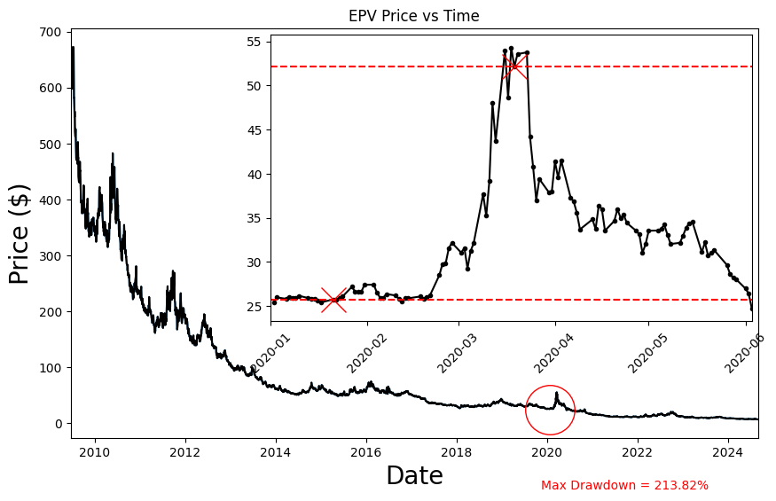
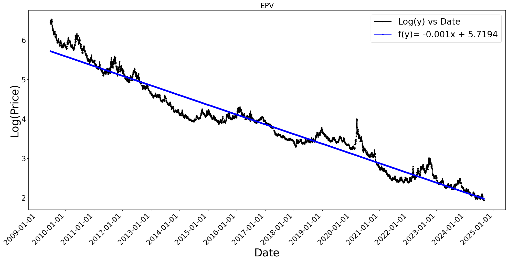
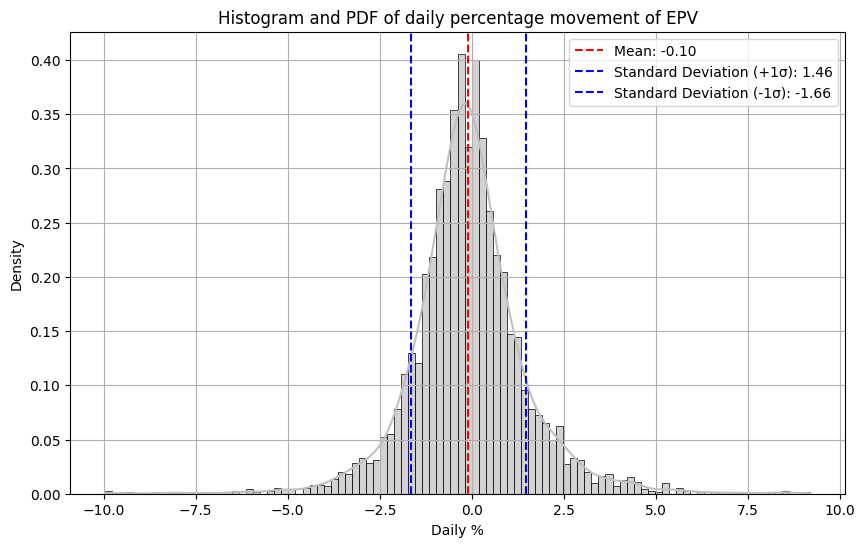

## BCBCLI
The Bloomberg Commodity Balanced WTI Crude Oil Index (ticker: BCBCLI Index) aims to track the performance of 3 separate contract schedules for WTI Crude Oil futures. One third of the index follows a monthly roll schedule, the second third of the index follows a June annual roll schedule, while the remaining third follows a December annual roll schedule.

The Index weights are equally reset semi-annually in the months of March and September on close of the first Business Day. To maintain the long position of the basket, contracts are ‘rolled’ from the expiring futures contract to a new contract farther down the futures curve with a longer expiry date. All commodities will roll on the second and the third Business Day of each calendar month
- ## Derivatives
- SCO ProShares UltraShort Bloomberg Crude Oil seeks daily investment results, before fees and expenses, that correspond to two times the inverse (-2x) of the daily performance of the Bloomberg Commodity Balanced WTI Crude Oil Index. https://www.proshares.com/our-etfs/leveraged-and-inverse/sco
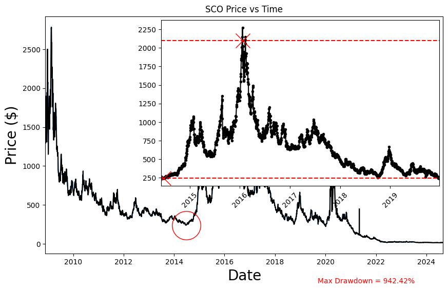
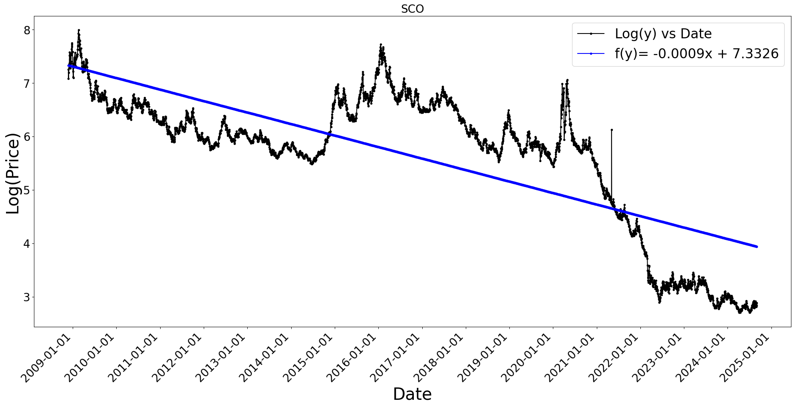
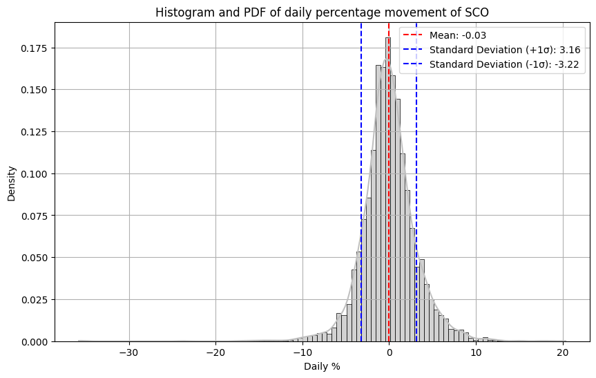

## BCOMGC
The Bloomberg Gold SubindexSM, a subindex of the Bloomberg Commodity Index, is intended to reflect the performance of gold as measured by the price of COMEX gold futures contracts.

It is a "rolling index," which means that it does not take physical possession of any commodities. The roll occurs over a period of five business days in certain months according to a pre-determined schedule, generally beginning on the sixth business day of the month and ending on the tenth business day. Each day, approximately 20% of each rolling futures position that is included in the month's roll is rolled, increasing from 0% to 20%, 40%, 60%, 80% and finally 100%.

The Gold Subindex will reflect the performance of its underlying COMEX gold futures contracts, including the impact of rolling, without regard to income earned on cash positions.
- ## Derivatives
- GLL ProShares UltraShort Gold seeks daily investment results, before fees and expenses, that correspond to two times the inverse (-2x) of the daily performance of the Bloomberg Gold Subindex. https://www.proshares.com/our-etfs/leveraged-and-inverse/gll
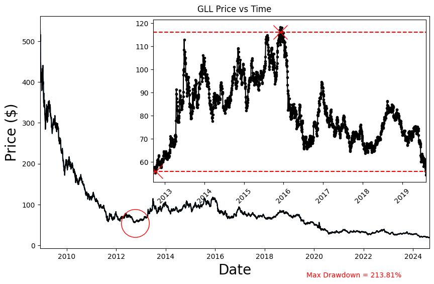
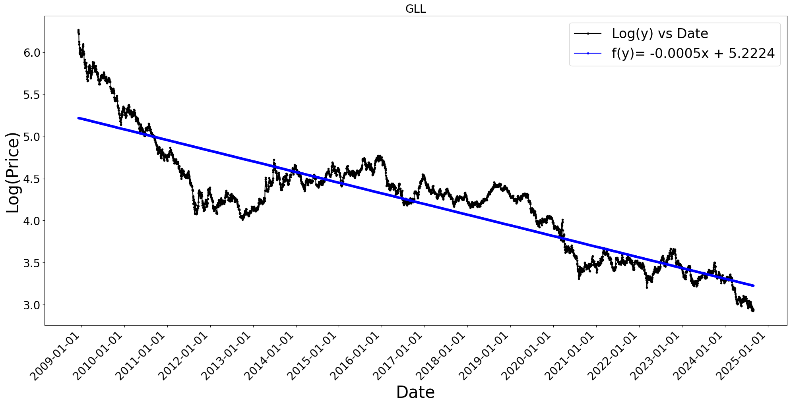
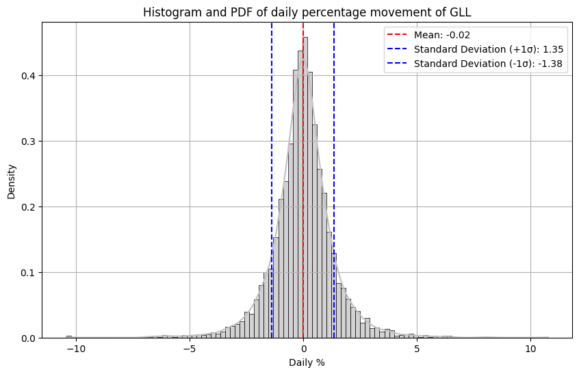

## BCOMNG
The Bloomberg Natural Gas SubindexSM is intended to reflect the natural gas segment of the commodities market. The index consists of futures contracts on natural gas.

Unlike equities, which entitle the holder to a continuing stake in a corporation, commodity futures contracts specify a delivery date for an underlying physical commodity. The index measures the performance of commodity futures contracts, and, as the date for a futures contract comes due, the index replaces such contract with similar contracts with later expirations. The index thus is a "rolling" index.

The index is valued using the settlement prices for the underlying futures contracts. The index rolls its contracts over the course of 5 consecutive business days, starting on the 6th business day of the month. Each day, approximately 20% of each futures position that is included in the month's roll is rolled.
- ## Derivatives
- KOLD ProShares UltraShort® Bloomberg Natural Gas seeks daily investment results, before fees and expenses, that correspond to two times the inverse (-2x) of the daily performance of the Bloomberg Natural Gas SubindexSM. https://www.proshares.com/our-etfs/leveraged-and-inverse/kold
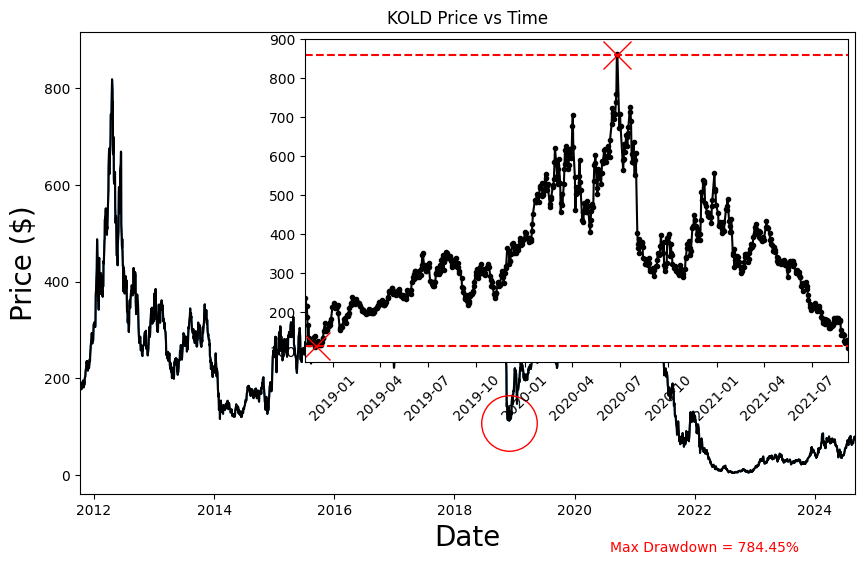
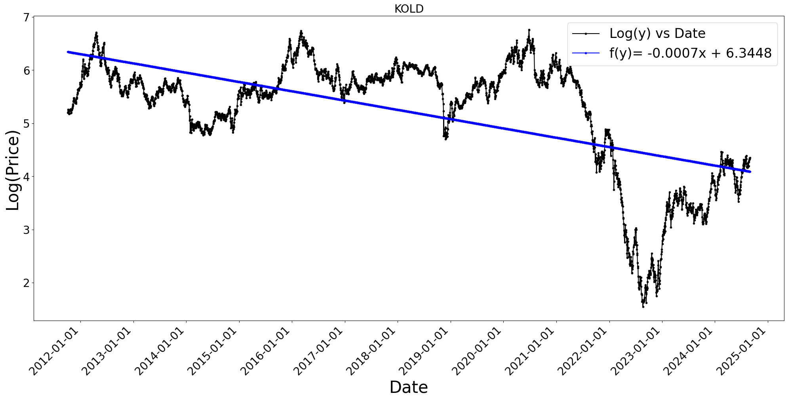
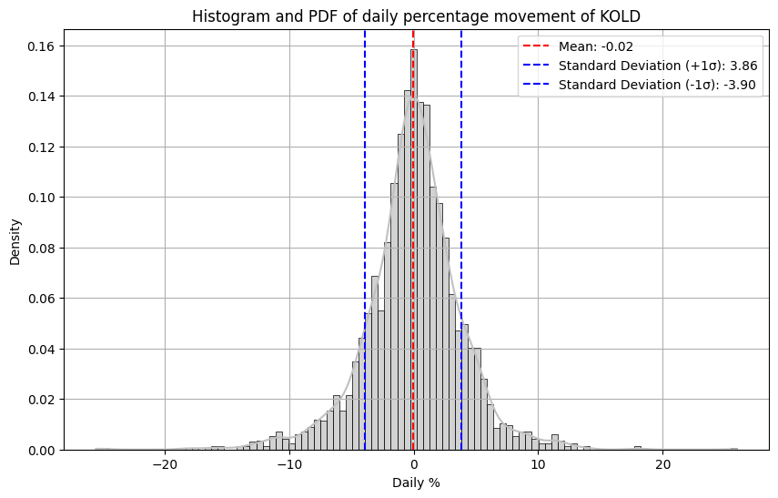

## BCOMSI
The Bloomberg Silver SubindexSM, a subindex of the Bloomberg Commodity Index, is intended to reflect the performance of silver as measured by the price of COMEX silver futures contracts.

It is a "rolling index," which means that it does not take physical possession of any commodities. The roll occurs over a period of five business days in certain months according to a pre-determined schedule, generally beginning on the sixth business day of the month and ending on the tenth business day. Each day, approximately 20% of each rolling futures position that is included in the month's roll is rolled, increasing from 0% to 20%, 40%, 60%, 80% and finally 100%.

The Silver Subindex will reflect the performance of its underlying COMEX silver futures contracts, including the impact of rolling, without regard to income earned on cash positions.
- ## Derivatives
- ZSL ProShares UltraShort Silver seeks daily investment results, before fees and expenses, that correspond to two times the inverse (-2x) of the daily performance the Bloomberg Silver SubindexSM. https://www.proshares.com/our-etfs/leveraged-and-inverse/zsl
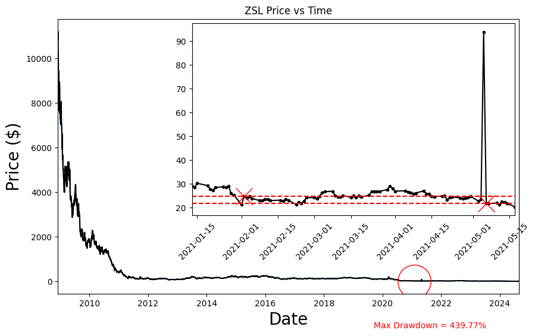
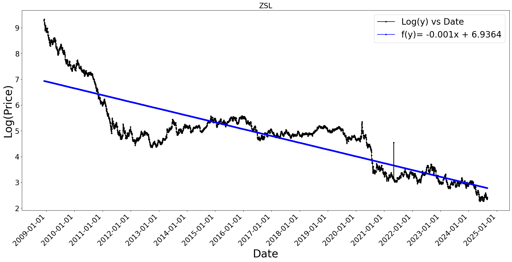
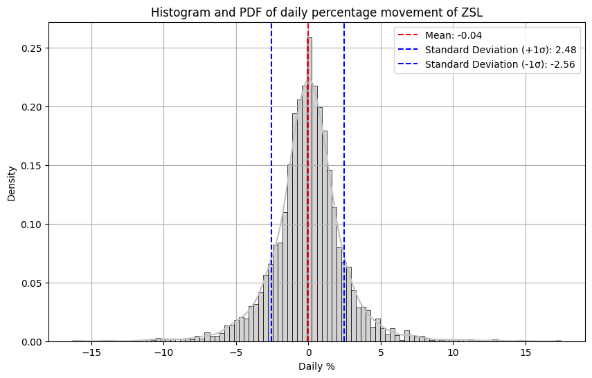

## DJUSSC
The Dow Jones U.S. Semiconductor Index measures the performance of the semiconductor industry of the U.S. equity market. Component companies are engaged in the production of semiconductors and other integrated chips, as well as other related products such as circuit boards and motherboards.
- ## Derivatives
- SSG ProShares UltraShort Semiconductors seeks daily investment results, before fees and expenses, that correspond to two times the inverse (-2x) of the daily performance of the Dow Jones U.S. SemiconductorsSM Index. https://www.proshares.com/our-etfs/leveraged-and-inverse/ssg
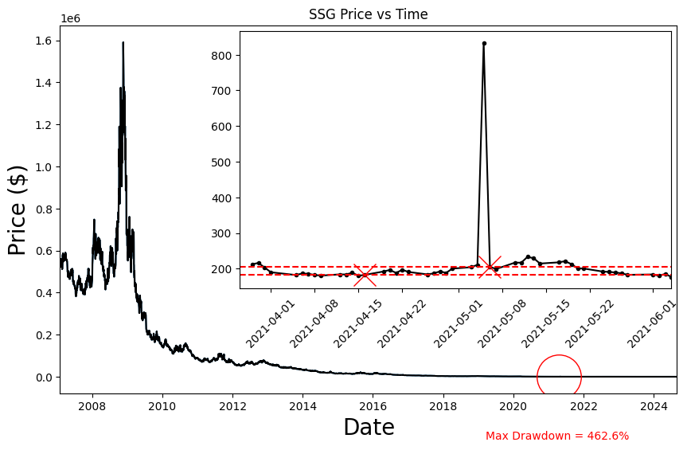
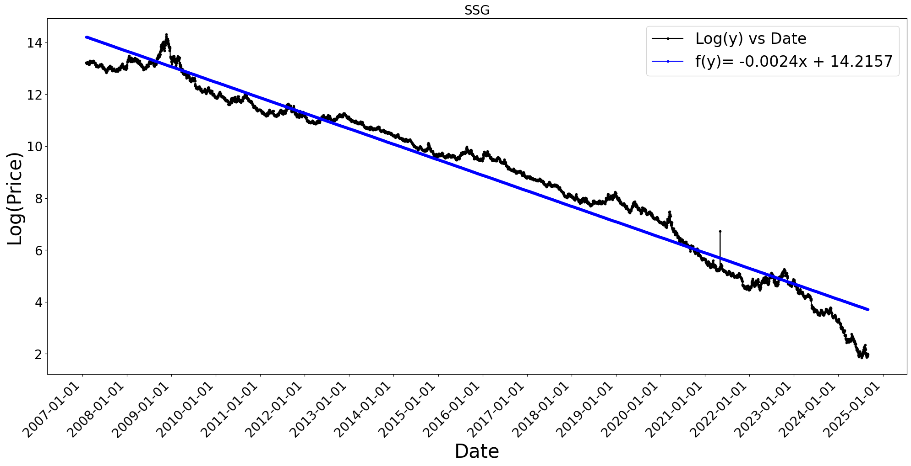
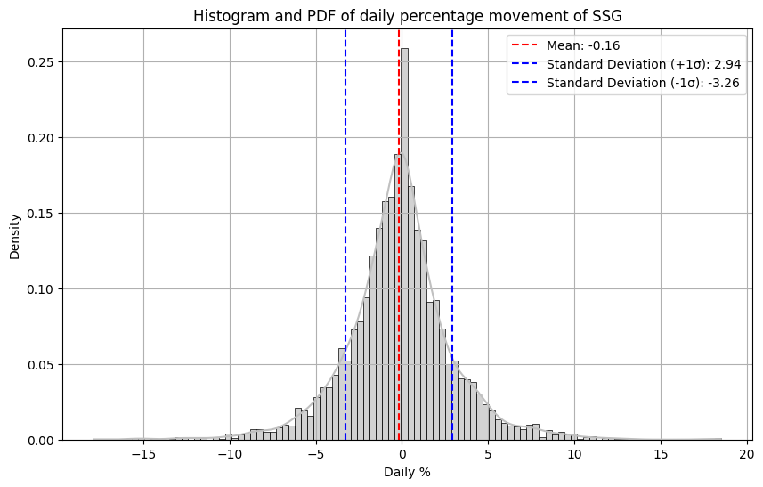

## DOW
- The Dow Jones Industrial Average, Dow Jones, or simply the Dow, is a stock market index of 30 prominent companies listed on stock exchanges in the United States.
- ## Derivatives
- DOG ProShares Short Dow30 seeks daily investment results, before fees and expenses, that correspond to the inverse (-1x) of the daily performance of the Dow Jones Industrial Average. https://www.proshares.com/our-etfs/leveraged-and-inverse/dog

- DXD ProShares UltraShort Dow30 seeks daily investment results, before fees and expenses, that correspond to two times the inverse (-2x) of the daily performance of the Dow Jones Industrial Average. https://www.proshares.com/our-etfs/leveraged-and-inverse/dxd

- SDOW ProShares UltraPro Short Dow30 seeks daily investment results, before fees and expenses, that correspond to three times the inverse (-3x) of the daily performance of the Dow Jones Industrial Average. https://www.proshares.com/our-etfs/leveraged-and-inverse/sdow

## EURO
The euro benchmark is the 4:00 p.m. ET euro in U.S. dollar terms (EUR/USD cross rate) as published by Bloomberg.
- ## Derivatives
- EUO ProShares UltraShort Euro seeks daily investment results, before fees and expenses, that correspond to two times the inverse (-2x) of the daily performance of the price of the euro versus the U.S. dollar.https://www.proshares.com/our-etfs/leveraged-and-inverse/euo
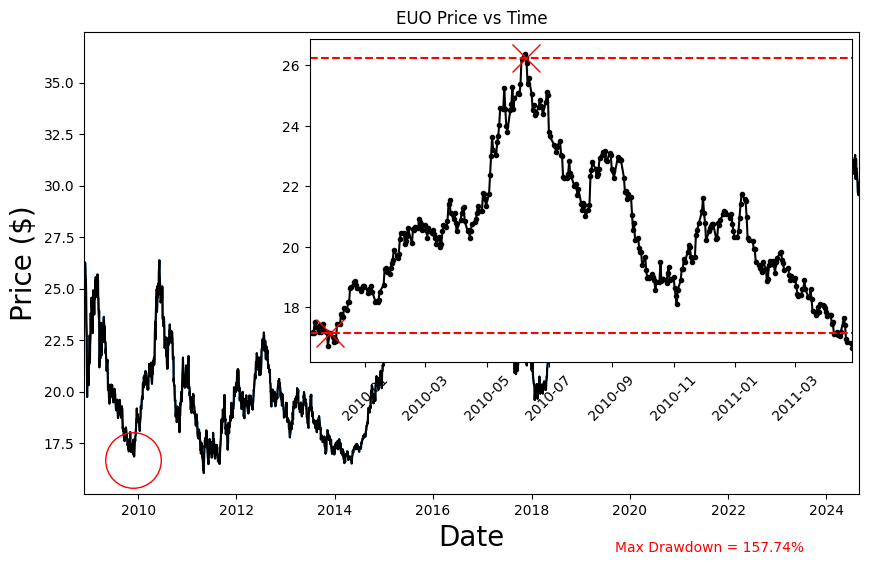
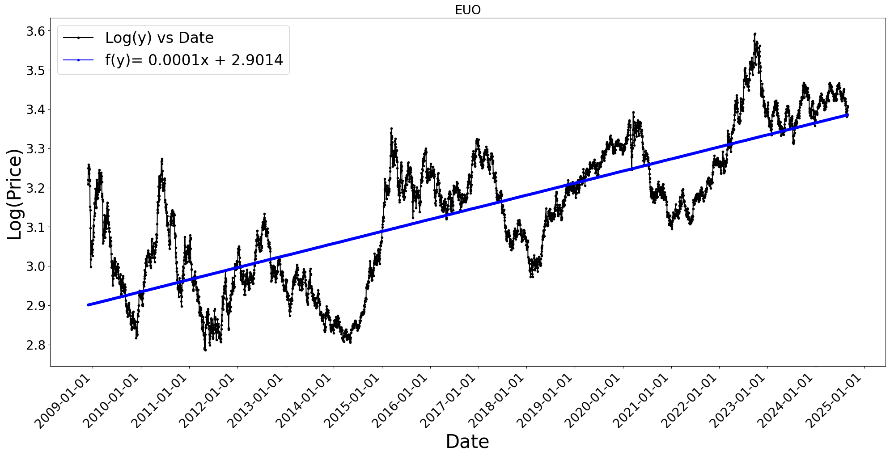
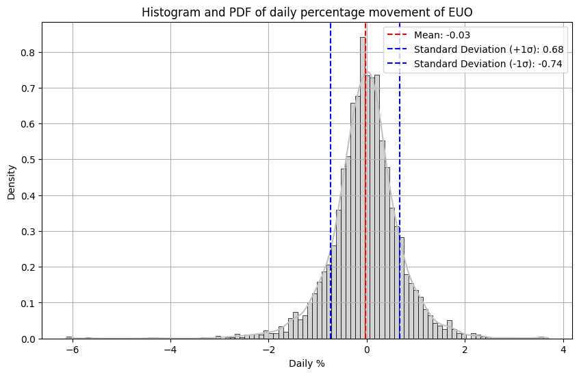

## GDMNTR
The NYSE Arca Gold Miners Index (GDMNTR) is a modified market capitalization weighted index comprised of publicly traded companies that operate globally in both developed and emerging markets, and are involved primarily in mining for gold and, to a lesser extent, in mining for silver. The Index will limit the weight of companies whose revenues are more significantly exposed to silver mining to less than 20% of the Index at each rebalance date. The Index may include small- and mid-capitalization companies and foreign issuers.
- ## Derivatives
- DUST The Direxion Daily Gold Miners Index Bull and Bear 2X Shares seek daily investment results, before fees and expenses, of either 200%, or 200% of the inverse (or opposite), of the performance of the NYSE Arca Gold Miners Index.
https://www.direxion.com/product/daily-gold-miners-bull-bear-2x-etfs
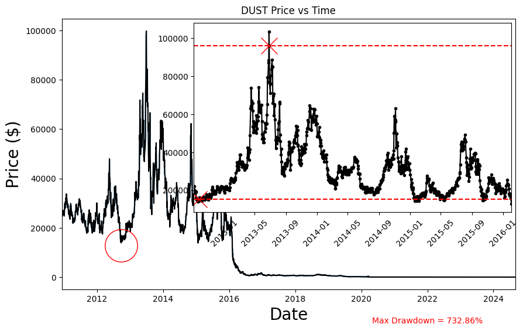
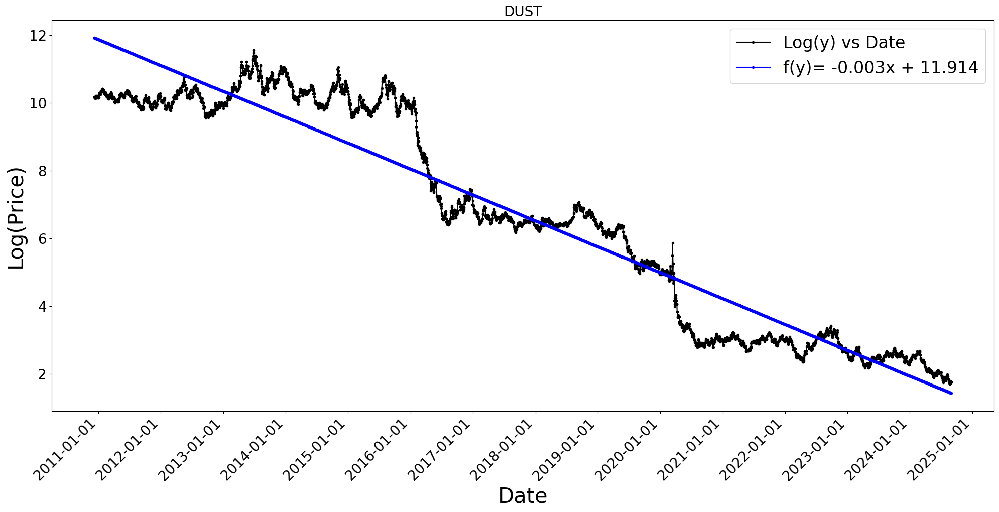
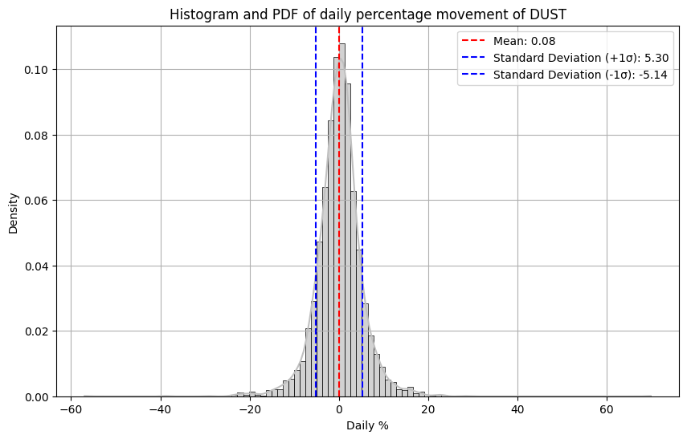

## IBOXHY
Markit iBoxx® $ Liquid High Yield Index is a modified market-value weighted index designed to provide a balanced representation of U.S. dollar-denominated high yield corporate bonds for sale within the United States by means of including the most liquid high yield corporate bonds available as determined by the index provider. Currently, the bonds eligible for inclusion in the Index include U.S. dollar-denominated, corporate bonds for sale in the United States that are issued by companies domiciled in the U.S., Bermuda, Canada, Cayman Islands, Western Europe or Japan; are rated sub-investment grade by Moody’s Investors Service, Inc., Fitch, Inc. or Standard and Poor's Financial Services, LLC; are from issuers with at least $1 billion par outstanding; have at least $400 million of outstanding face value; and are between three and fifteen years to maturity. There is no limit to the number of issues in the Index. Index rebalances occur monthly.
- ## Derivatives
- SJB ProShares Short High Yield seeks daily investment results, before fees and expenses, that correspond to the inverse (-1x) of the daily performance of the Markit iBoxx $ Liquid High Yield Index.https://www.proshares.com/our-etfs/leveraged-and-inverse/sjb
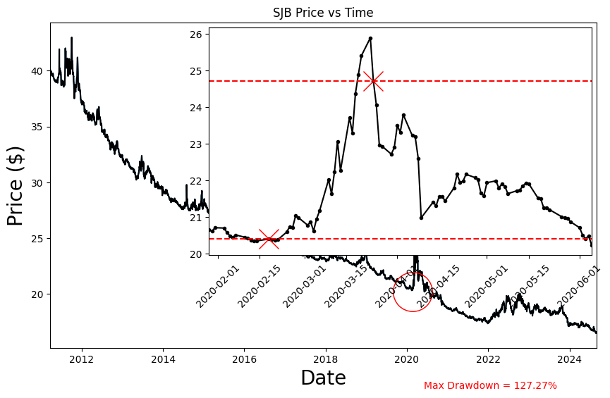
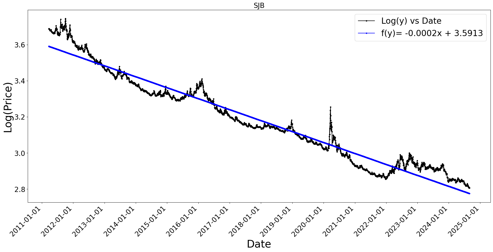
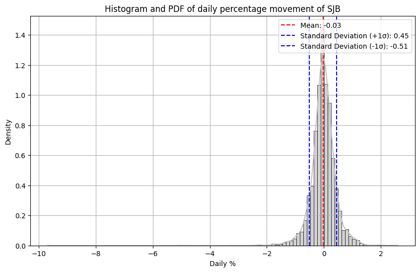

## IDCOT20T
The ICE U.S. Treasury 20+ Year Bond Index includes publicly- issued U.S. Treasury securities that have a remaining maturity greater than twenty years and have $300 million or more of outstanding face value, excluding amounts held by the Federal Reserve. In addition, the securities in the Underlying Index must be fixed-rate and denominated in U.S. dollars. Excluded from the Underlying Index are inflation-linked securities, Treasury bills, cash management bills, any government agency debt issued with or without a government guarantee and zero-coupon issues that have been stripped from coupon-paying bonds. The Underlying Index is weighted by market capitalization, and the securities in the Underlying Index are updated on the last business day of each month.
- ## Derivatives
- TBF ProShares Short 20+ Year Treasury seeks daily investment results, before fees and expenses, that correspond to the inverse (-1x) of the daily performance of the ICE U.S. Treasury 20+ Year Bond Index.https://www.proshares.com/our-etfs/leveraged-and-inverse/tbf
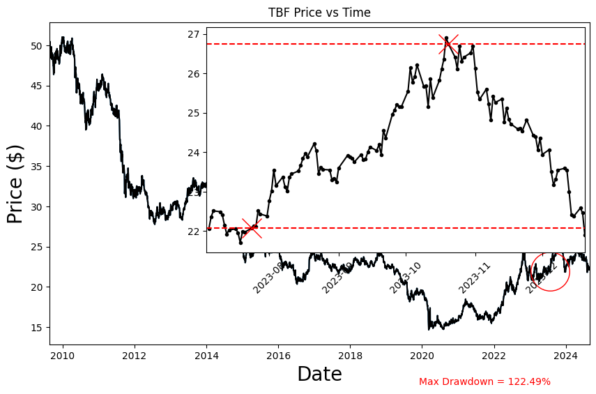
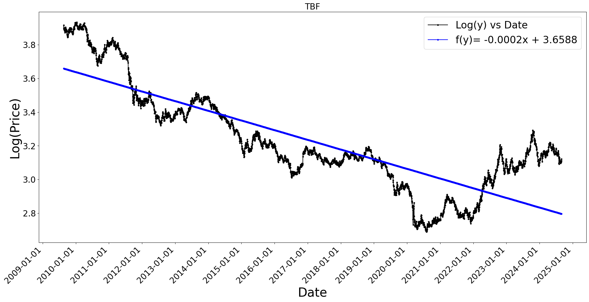
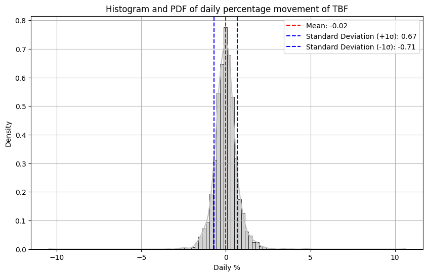
- TBT ProShares UltraShort 20+ Year Treasury seeks daily investment results, before fees and expenses, that correspond to two times the inverse (-2x) of the daily performance of the ICE U.S. Treasury 20+ Year Bond Index. https://www.proshares.com/our-etfs/leveraged-and-inverse/tbt
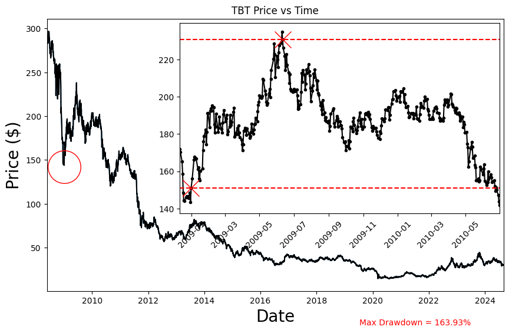
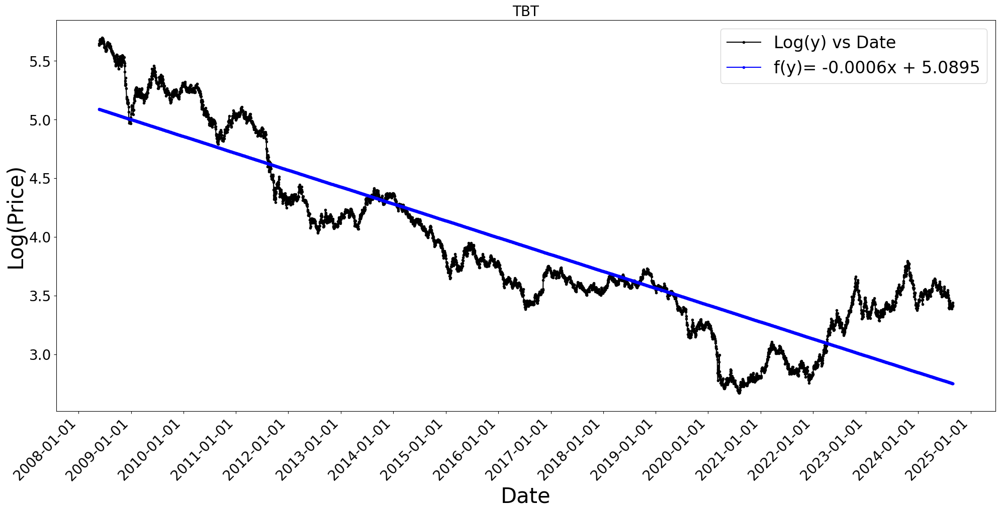
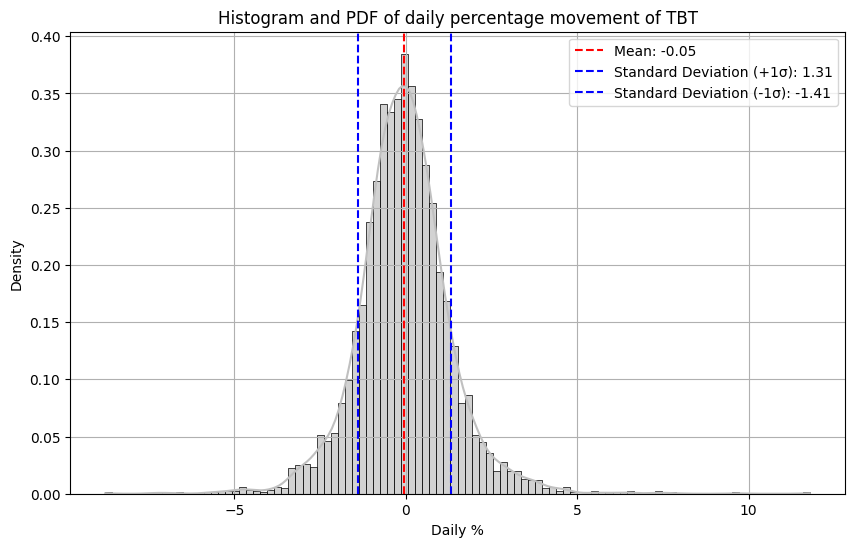
- TTT ProShares UltraPro Short® 20+ Year Treasury seeks daily investment results, before fees and expenses, that correspond to three times the inverse (-3x) of the daily performance of the ICE U.S. Treasury 20+ Year Bond Index.https://www.proshares.com/our-etfs/leveraged-and-inverse/ttt
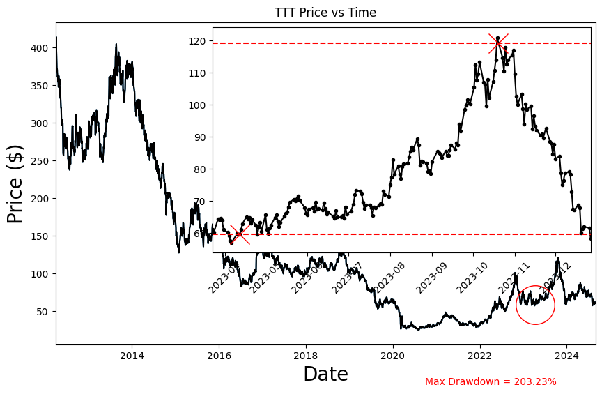
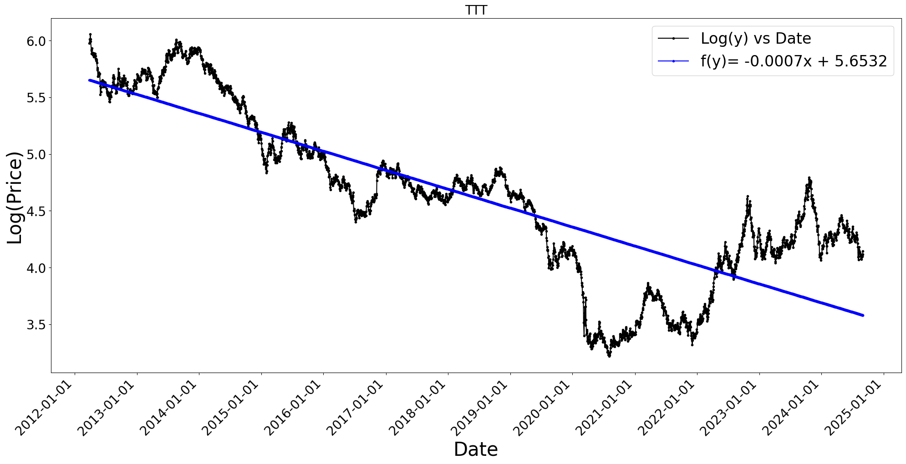
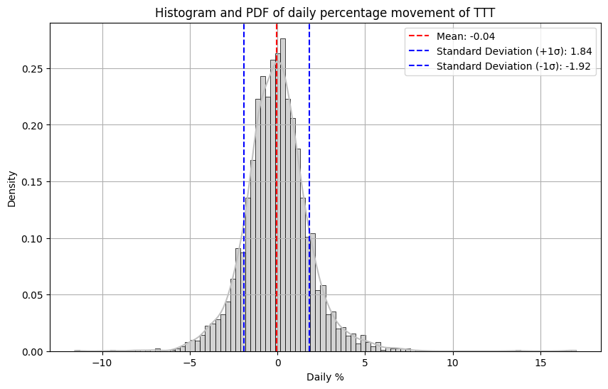

## IDCOT7TR
The ICE U.S. Treasury 7-10 Year Bond Index includes publicly-issued U.S. Treasury securities that have a remaining maturity of greater than seven years and less than or equal to ten years and have $300 million or more of outstanding face value, excluding amounts held by the Federal Reserve. In addition, the securities in the Underlying Index must be fixed-rate and denominated in U.S. dollars. Excluded from the Underlying Index are inflation-linked securities, Treasury bills, cash management bills, any government agency debt issued with or without a government guarantee and zero-coupon issues that have been stripped from coupon-paying bonds. The Underlying Index is weighted by market capitalization, and the securities in the Underlying Index are updated on the last business day of each month.
- ## Derivatives
- TBX ProShares Short 7-10 Year Treasury seeks daily investment results, before fees and expenses, that correspond to the inverse (-1x) of the daily performance of the ICE U.S. Treasury 7-10 Year Bond Index.https://www.proshares.com/our-etfs/leveraged-and-inverse/tbx
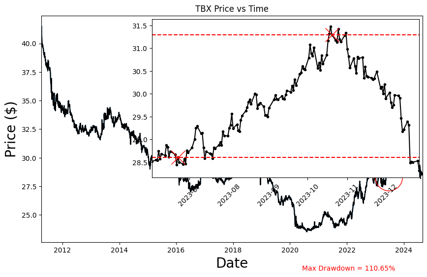
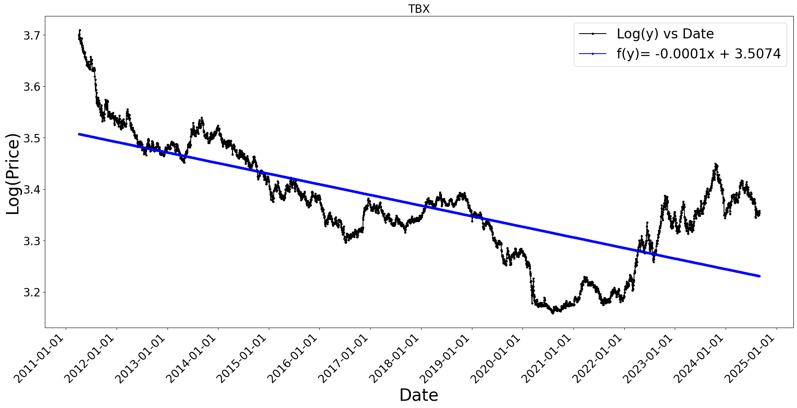
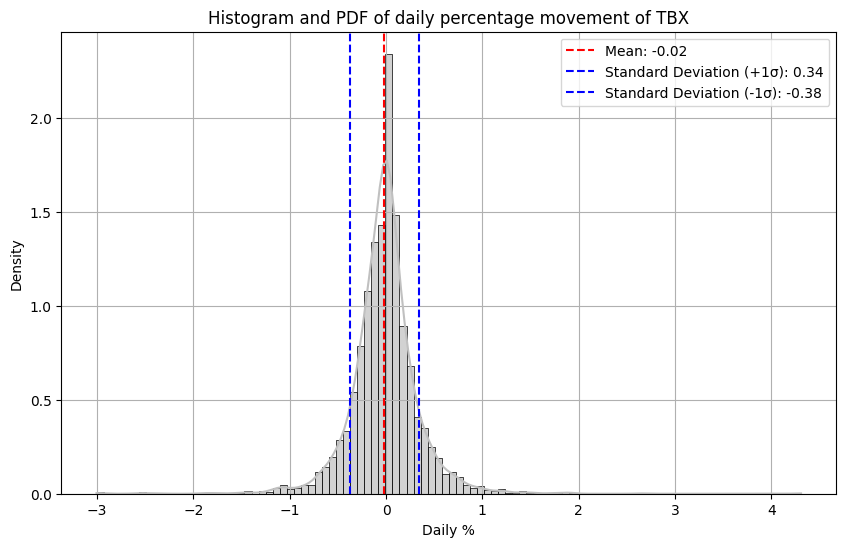
- PST ProShares UltraShort 7-10 Year Treasury seeks daily investment results, before fees and expenses that correspond to two times the inverse (-2x) of the daily performance of the ICE U.S. Treasury 7-10 Year Bond Index.
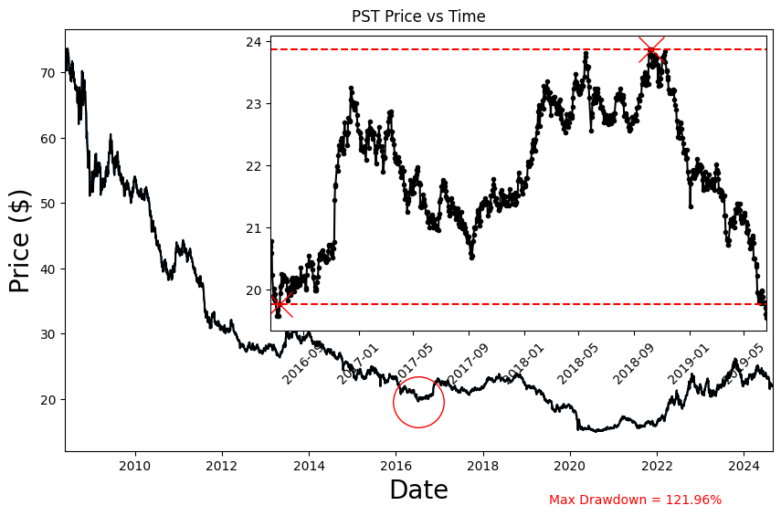
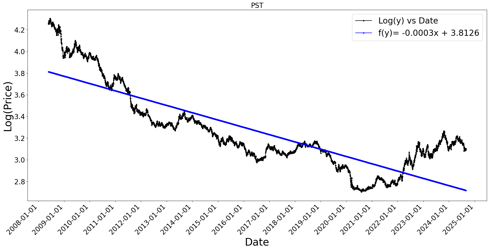
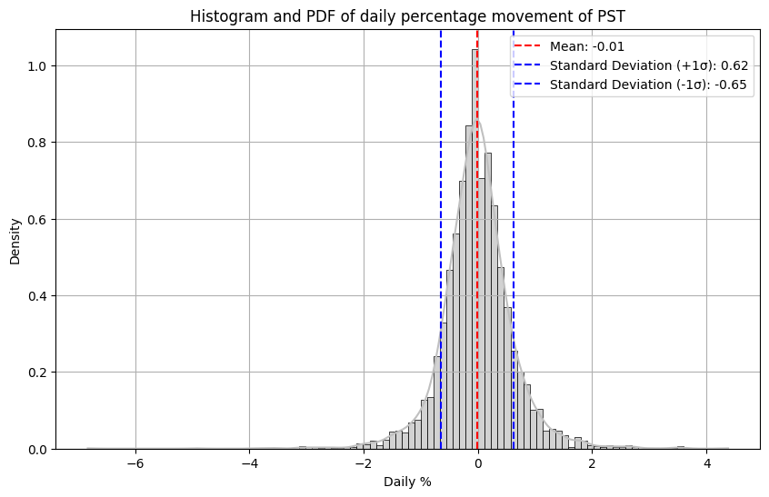

## IXB
The Index represents the materials sector of the S&P 500 Index (“S&P 500”). The Index is one of eleven S&P Select Sector Indices, each designed to measure the performance of a sector of the S&P 500. The Index includes equity securities of companies from the following Global Industry Classification Standard (GICS®) industries: chemicals; construction materials; containers & packaging; metals & mining; and paper & forest products.
- ## Derivatives
- SMN ProShares UltraShort Materials seeks daily investment results, before fees and expenses, that correspond to two times the inverse (-2x) of the daily performance of the S&P Materials Select Sector Index.https://www.proshares.com/our-etfs/leveraged-and-inverse/smn
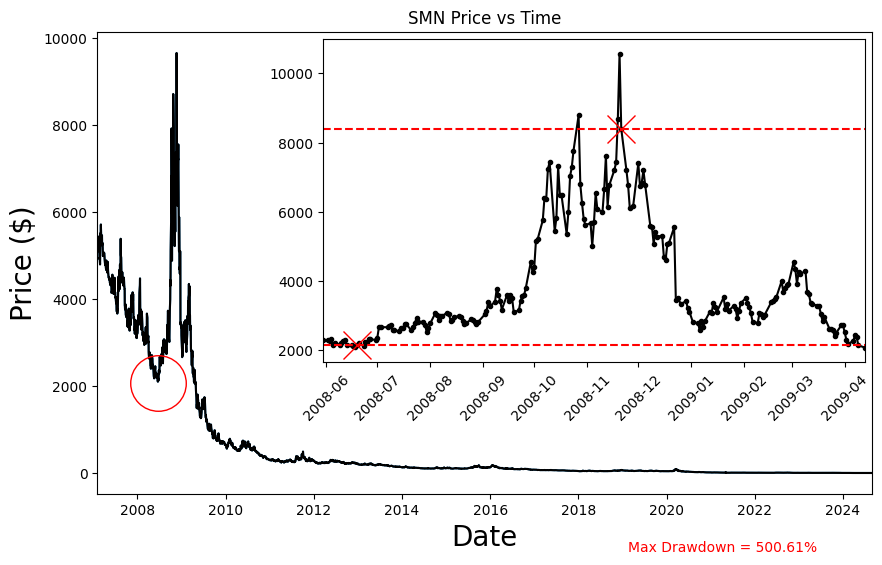
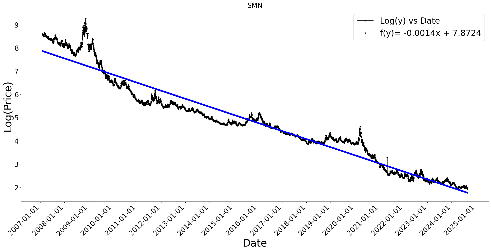
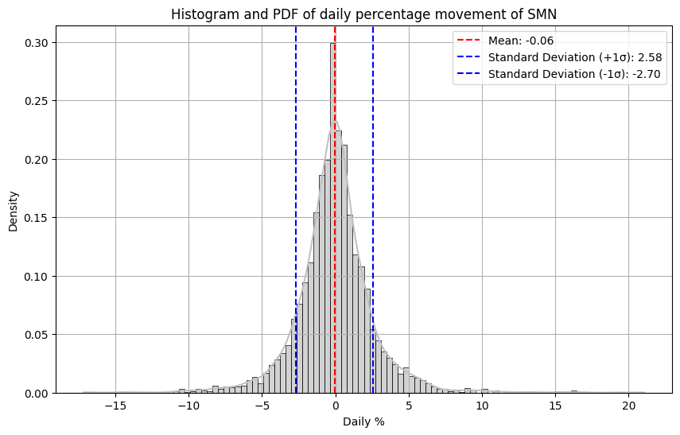

## IXE
The Index represents the energy sector of the S&P 500 Index (“S&P 500”). The Index is one of eleven S&P Select Sector Indices, each designed to measure the performance of a sector of the S&P 500. The Index includes equity securities of companies from the following Global Industry Classification Standard (GICS®) industries: energy equipment & services and oil & gas consumable fuels.
- ## Derivatives
- DUG ProShares UltraShort Energy seeks daily investment results, before fees and expenses, that correspond to two times the inverse (-2x) of the daily performance of the S&P Energy Select Sector Index.https://www.proshares.com/our-etfs/leveraged-and-inverse/dug
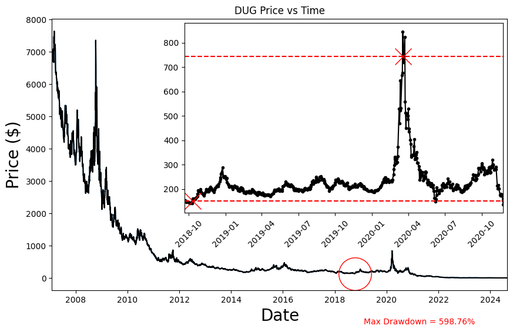
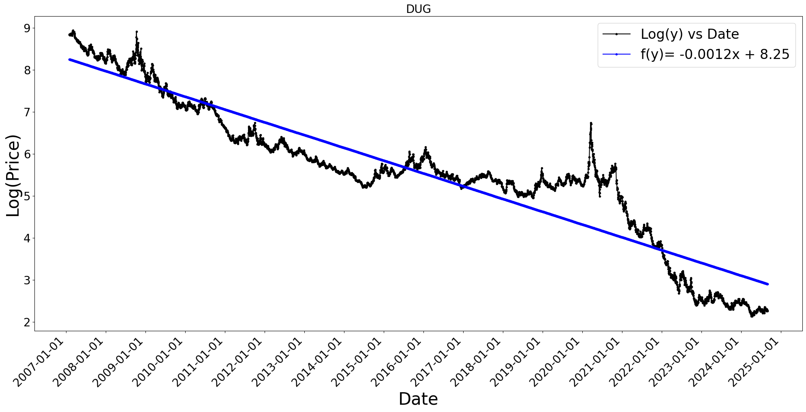
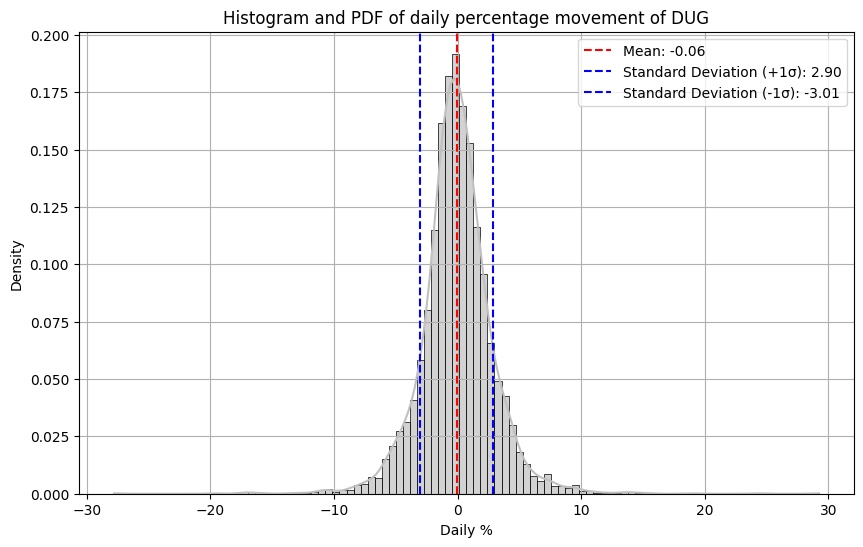

## IXI
The Index represents the industrials sector of the S&P 500 Index (“S&P 500”). The Index is one of eleven S&P Select Sector Indices, each designed to measure the performance of a sector of the S&P 500. The Index includes equity securities of companies from the following Global Industry Classification Standard (GICS®) industries: aerospace & defense; building products; construction & engineering; electrical equipment; industrial conglomerates; machinery; trading companies & distributors; commercial services & supplies; professional services; air freight & logistics; airlines; marine; road & rail; and transportation infrastructure.
- ## Derivatives
- SIJ ProShares UltraShort Industrials seeks daily investment results, before fees and expenses, that correspond to two times the inverse (-2x) of the daily performance of the S&P Industrials Select Sector Index. https://www.proshares.com/our-etfs/leveraged-and-inverse/sij
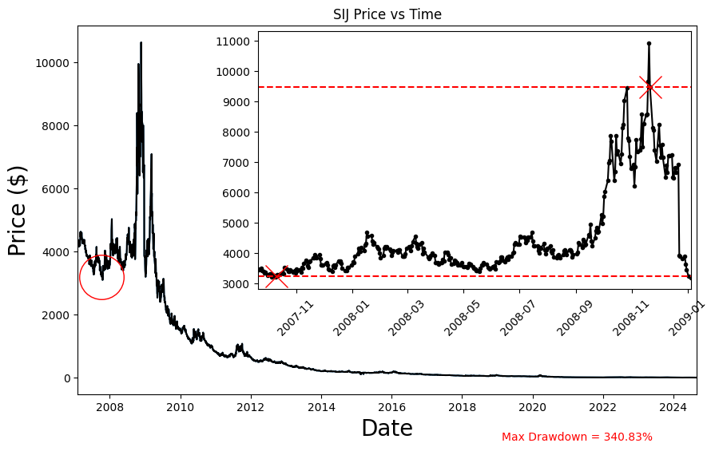

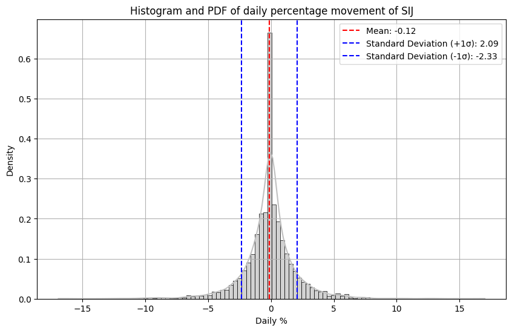

## IXM
The Index represents the financials sector of the S&P 500 Index (“S&P 500”). The Index is one of eleven S&P Select Sector Indices, each designed to measure the performance of a sector of the S&P 500. The Index includes equity securities of companies from the following Global Industry Classification Standard (GICS®) industries: banks; thrifts & mortgage finance; diversified financial services; consumer finance; capital markets; mortgage real estate investment trusts (REITs); and insurance.
- ## Derivatives
- SEF ProShares Short Financials seeks daily investment results, before fees and expenses, that correspond to the inverse (-1x) of the daily performance of the S&P Financial Select Sector Index.https://www.proshares.com/our-etfs/leveraged-and-inverse/sef

## IXMTR
The Financial Select Sector Index (IXMTR) is provided by S&P Dow Jones Indices and includes securities of companies from the following industries: Banks; Thrifts & Mortgage Finance; Diversified Financial Services; Consumer Finance; Capital Markets; Insurance; and Mortgage Real Estate Investment Trusts (REITs). One cannot invest directly in an index.
- ## Derivatives
- FAZ The Direxion Daily Financial Bull and Bear 3X Shares seek daily investment results, before fees and expenses, of 300%, or 300% of the inverse (or opposite), of the performance of the Financial Select Sector Index. https://www.direxion.com/product/daily-financial-bull-bear-3x-etfs

## IXR
The Index represents the consumer staples sector of the S&P 500 Index (“S&P 500”). The Index is one of eleven S&P Select Sector Indices, each designed to measure the performance of a sector of the S&P 500. The Index includes equity securities of companies from the following Global Industry Classification Standard (GICS®) industries: food & staples retailing; beverages; food products; tobacco; household products; and personal products.
- ## Derivatives
- SZK ProShares UltraShort Consumer Staples seeks daily investment results, before fees and expenses, that correspond to two times the inverse (-2x) of the daily performance of the S&P Consumer Staples Select Sector Index.https://www.proshares.com/our-etfs/leveraged-and-inverse/szk

## IXRE
The Index represents the real estate sector of the S&P 500 Index (“S&P 500”). The Index is one of eleven S&P Select Sector Indices, each designed to measure the performance of a sector of the S&P 500. The Index includes equity securities of companies from the following Global Industry Classification Standard (GICS®) industries: equity real estate investment trusts (REITs) and real estate management & development.
- ## Derivatives
- SRS ProShares UltraShort Real Estate seeks daily investment results, before fees and expenses, that correspond to two times the inverse (-2x) of the daily performance of the S&P Real Estate Select Sector Index.https://www.proshares.com/our-etfs/leveraged-and-inverse/srs

## IXU
The Index represents the utilities sector of the S&P 500 Index (“S&P 500”). The Index is one of eleven S&P Select Sector Indices, each designed to measure the performance of a sector of the S&P 500. The Index includes equity securities of companies from the following Global Industry Classification Standard (GICS®) industries: electric utilities; gas utilities; multi-utilities; water utilities; and independent power and renewable electricity producers.
- ## Derivatives
- SDP ProShares UltraShort Utilities seeks daily investment results, before fees and expenses, that correspond to two times the inverse (-2x) of the daily performance of the S&P Utilities Select Sector Index.https://www.proshares.com/our-etfs/leveraged-and-inverse/sdp

## IXV
The Index represents the health care sector of the S&P 500 Index (“S&P 500”). The Index is one of eleven S&P Select Sector Indices, each designed to measure the performance of a sector of the S&P 500. The Index includes equity securities of companies from the following Global Industry Classification Standard (GICS®) industries: health care equipment & supplies, health care providers & services; health care technology; biotechnology; pharmaceuticals; and life sciences tools & services.
- ## Derivatives
- RXD ProShares UltraShort Health Care seeks daily investment results, before fees and expenses, that correspond to two times the inverse (-2x) of the daily performance of the S&P Health Care Select Sector Index.https://www.proshares.com/our-etfs/leveraged-and-inverse/rxd

## IXY
The Index represents the consumer discretionary sector of the S&P 500 Index (“S&P 500”). The Index is one of eleven S&P Select Sector Indices, each designed to measure the performance of a sector of the S&P 500. The Index includes equity securities of companies from the following Global Industry Classification Standard (GICS®) industries: auto components; automobiles; household durables; leisure products; textiles, apparel & luxury goods; hotels, restaurants & leisure; diversified consumer services; distributors; internet & direct marketing retail; multiline retail; and specialty retail.
- ## Derivatives
- SCC ProShares UltraShort Consumer Discretionary seeks daily investment results, before fees and expenses, that correspond to two times the inverse (-2x) of the daily performance of the S&P Consumer Discretionary Select Sector Index. https://www.proshares.com/our-etfs/leveraged-and-inverse/scc

## IXT
The Index represents the technology sector of the S&P 500 Index (“S&P 500”). The Index is one of eleven S&P Select Sector Indices, each designed to measure the performance of a sector of the S&P 500. The Index includes equity securities of companies from the following Global Industry Classification Standard (GICS®) industries: IT services; software; communications equipment; technology, hardware, storage & peripherals; electronic equipment, instruments & components; and semiconductors & semiconductor equipment.
- ## Derivatives
- REW ProShares UltraShort Technology seeks daily investment results, before fees and expenses, that correspond to two times the inverse (-2x) of the daily performance of the S&P Technology Select Sector Index.https://www.proshares.com/our-etfs/leveraged-and-inverse/rew

## MID
The S&P MidCap 400 Index is a widely used measure of mid-size company U.S. stock market performance. Companies are selected for inclusion in the Index by Standard & Poor's based on adequate liquidity, appropriate market capitalization, financial viability and public float.
- ## Derivatives
- MYY ProShares Short MidCap400 seeks daily investment results, before fees and expenses, that correspond to the inverse (-1x) of the daily performance of the S&P MidCap 400®.https://www.proshares.com/our-etfs/leveraged-and-inverse/myy

- MZZ ProShares UltraShort MidCap400 seeks daily investment results, before fees and expenses, that correspond to two times the inverse (-2x) of the daily performance of the S&P MidCap 400®. https://www.proshares.com/our-etfs/leveraged-and-inverse/mzz

- SMDD ProShares UltraPro Short MidCap400 seeks daily investment results, before fees and expenses, that correspond to three times the inverse (-3x) of the daily performance of the S&P MidCap 400®.https://www.proshares.com/our-etfs/leveraged-and-inverse/smdd

## MVGDXJTR
The MVIS Global Junior Gold Miners Index (MVGDXJTR) tracks the performance of foreign and domestic micro-, small- and mid-capitalization companies that generate, or demonstrate the potential to generate, at least 50% of their revenues from, or have at least 50% of their assets related to, gold mining and/or silver mining, hold real property or have mining projects that have the potential to produce at least 50% of the company’s revenue from gold or silver mining when developed, or primarily invest in gold or silver. https://www.direxion.com/product/daily-junior-gold-miners-bull-bear-2x-etfs
- ## Derivatives
- JDST The Direxion Daily Junior Gold Miners Index Bull and Bear 2X Shares seek daily investment results, before fees and expenses, of 200%, or 200% of the inverse (or opposite), of the performance of the MVIS Global Junior Gold Miners Index.

## MXBR2550
The MSCI Brazil 25/50 Index® is a free-float-adjusted, market capitalization weighted index that is designed to measure the equity market performance of the Brazilian market. The Index is divided into large- and mid-cap segments and targets approximately 85% of free-float-adjusted market capitalization of the region.

Derivative contracts are priced to reflect the underlying index yield and will not generate dividend income. Because ProShares invest in derivatives, they will not have dividend distributions that reflect those of their applicable indexes.
- ## Derivatives
- BZQ ProShares UltraShort MSCI Brazil Capped seeks daily investment results, before fees and expenses, that correspond to two times the inverse (-2x) of the daily performance of the MSCI Brazil 25/50 Index®. https://www.proshares.com/our-etfs/leveraged-and-inverse/bzq

## MXEA
The MSCI EAFE Index includes 85% of free float-adjusted, market capitalization in each industry group in developed market countries, excluding the U.S. and Canada. As of June 30, 2023, the Index consisted of the following 21 developed market country indexes: Australia, Austria, Belgium, Denmark, Finland, France, Germany, Hong Kong, Ireland, Israel, Italy, Japan, the Netherlands, New Zealand, Norway, Portugal, Singapore, Spain, Sweden, Switzerland, and the United Kingdom.
- ## Derivatives
- EFZ ProShares Short MSCI EAFE seeks daily investment results, before fees and expenses, that correspond to the inverse (-1x) of the daily performance of the MSCI EAFE Index®. https://www.proshares.com/our-etfs/leveraged-and-inverse/efz

- EFU ProShares UltraShort MSCI EAFE seeks daily investment results, before fees and expenses, that correspond to two times the inverse (-2x) of the daily performance of the MSCI EAFE Index®. https://www.proshares.com/our-etfs/leveraged-and-inverse/efu

## MXEF
The MSCI Emerging Markets Index covers approximately 85% of the market capitalization in emerging market countries. As of June 30, 2023, the Index consisted of the following 24 emerging market country indexes: Brazil, Chile, China, Colombia, Czech Republic, Egypt, Greece, Hungary, India, Indonesia, Korea, Kuwait, Malaysia, Mexico, Peru, Philippines, Poland, Qatar, Saudi Arabia, South Africa, Taiwan, Thailand, Turkey and United Arab Emirates.

Derivative contracts are priced to reflect the underlying index yield and will not generate dividend income. Because ProShares invest in derivatives, they will not have dividend distributions that reflect those of their applicable indexes.
- ## Derivatives
- EUM ProShares Short MSCI Emerging Markets seeks daily investment results, before fees and expenses, that correspond to the inverse (-1x) of the daily performance of the MSCI Emerging Markets Index®.https://www.proshares.com/our-etfs/leveraged-and-inverse/eum

- EEV ProShares UltraShort MSCI Emerging Markets seeks daily investment results, before fees and expenses, that correspond to two times the inverse (-2x) of the daily performance of the MSCI Emerging Markets Index®.https://www.proshares.com/our-etfs/leveraged-and-inverse/eev

## MXJP
The MSCI Japan Index adjusts the market capitalization of index constituents for free float and targets for index inclusion 85% of free float-adjusted market capitalization in each industry group in Japan.
- ## Derivatives
- EWV ProShares UltraShort MSCI Japan seeks daily investment results, before fees and expenses, that correspond to two times the inverse (-2x) of the daily performance of the MSCI Japan Index®.https://www.proshares.com/our-etfs/leveraged-and-inverse/ewv

## NBI
The Nasdaq Biotechnology Index is a modified capitalization weighted index that includes securities of The Nasdaq Stock Market listed companies that are classified as either biotechnology or pharmaceutical. The securities also meet other eligibility criteria determined by The Nasdaq OMX Group, Inc., including minimum market capitalization and liquidity requirements.
- ## Derivatives
- BIS ProShares UltraShort Nasdaq Biotechnology seeks daily investment results, before fees and expenses, that correspond to two times the inverse (-2x) of the daily performance of the Nasdaq Biotechnology Index®.https://www.proshares.com/our-etfs/leveraged-and-inverse/bis

## NDX
The Nasdaq-100 is a stock market index made up of equity securities issued by 100 of the largest non-financial companies listed on the Nasdaq stock exchange. It is a modified capitalization-weighted index
- ## Derivatives
- PSQ ProShares Short QQQ seeks daily investment results, before fees and expenses, that correspond to the inverse (-1x) of the daily performance of the Nasdaq-100 Index. https://www.proshares.com/our-etfs/leveraged-and-inverse/psq

- QID ProShares UltraShort QQQ seeks daily investment results, before fees and expenses, that correspond to two times the inverse (-2x) of the daily performance of the Nasdaq-100 Index https://www.proshares.com/our-etfs/leveraged-and-inverse/qid

- SQQQ ProShares UltraPro Short QQQ seeks daily investment results, before fees and expenses, that correspond to three times the inverse (-3x) of the daily performance of the Nasdaq-100 Index. https://www.proshares.com/our-etfs/leveraged-and-inverse/sqqq

## SPSIOPTR
The S&P Oil & Gas Exploration & Production Select Industry Index (SPSIOPTR) is provided by Standard & Poor’s Index Provider and includes domestic companies from the oil and gas exploration and production sub-industry. The Index is a modified equal-weighted index that is designed to measure the performance of a sub-industry or group of sub-industries determined based on the Global Industry Classification Standards (GICS).
- ## Derivatives
- DRIP The Direxion Daily S&P Oil & Gas Exp. & Prod. Bull and Bear 2X Shares seek daily investment results, before fees and expenses, of 200%, or 200% of the inverse (or opposite), of the performance of the S&P Oil & Gas Exploration & Production Select Industry Index. https://www.direxion.com/product/daily-sp-oil-gas-exp-prod-bull-bear-2x-etfs

## RTY
The Russell 2000 Index consists of 2,000 of the smallest U.S.-domiciled, publicly traded common stocks included in the Russell 3000 Index.

- ## Derivatives
- RWM ProShares Short Russell2000 seeks daily investment results, before fees and expenses, that correspond to the inverse (-1x) of the daily performance of the Russell 2000® Index. https://www.proshares.com/our-etfs/leveraged-and-inverse/rwm

- TWM ProShares UltraShort Russell2000 seeks daily investment results, before fees and expenses, that correspond to two times the inverse (-2x) of the daily performance of the Russell 2000® Index. https://www.proshares.com/our-etfs/leveraged-and-inverse/twm

-  SRTY ProShares UltraPro Short® Russell2000 seeks daily investment results, before fees and expenses, that correspond to three times the inverse (-3x) of the daily performance of the Russell 2000® Index. https://www.proshares.com/our-etfs/leveraged-and-inverse/srty

## SML
The S&P SmallCap 600 Index covers the small-cap segment of the U.S. equities market, covering approximately 3% of the U.S. equities market.
- ## Derivatives
- SBB ProShares Short SmallCap600 seeks daily investment results, before fees and expenses, that correspond to the inverse (-1x) of the daily performance of the S&P SmallCap 600®. https://www.proshares.com/our-etfs/leveraged-and-inverse/sbb

- SDD ProShares UltraShort SmallCap600 seeks daily investment results, before fees and expenses, that correspond to two times the inverse (-2x) of the daily performance of the S&P SmallCap 600®. https://www.proshares.com/our-etfs/leveraged-and-inverse/sdd

## SOEMTYTR
To be included in the Solactive-ProShares Bricks and Mortar Retail Store Index, a retailer must be characterized as receiving at least 50% of its revenue from retail operations; receive 75% or more of its retail revenues from in-store sales; and be a U.S. company. In addition, a retailer must have a market capitalization of at least $500 million, a six-month daily average value traded of at least $1 million, and meet other requirements. The index is rebalanced monthly and reconstituted annually.
- ## Derivatives
- EMTY ProShares Decline of the Retail Store ETF seeks capital appreciation from the decline of bricks-and-mortar retailers through short exposure (-1x) to the Solactive-ProShares Bricks and Mortar Retail Store Index. https://www.proshares.com/our-etfs/leveraged-and-inverse/emty

## SPX
The Standard and Poor's 500, or simply the S&P 500, is a stock market index tracking the stock performance of 500 of the largest companies listed on stock exchanges in the United States.
- ## Derivatives
- SH ProShares Short S&P500 seeks daily investment results, before fees and expenses, that correspond to the inverse (-1x) of the daily performance of the S&P 500.
https://www.proshares.com/our-etfs/leveraged-and-inverse/sh

- SDS ProShares UltraShort® S&P500 seeks daily investment results, before fees and expenses, that correspond to two times the inverse (-2x) of the daily performance of the S&P 500®.
https://www.proshares.com/our-etfs/leveraged-and-inverse/sds

- SPXS seek daily investment results, before fees and expenses, of 300%, or 300% of the inverse (or opposite), of the performance of the S&P 500® Index.
https://www.direxion.com/product/daily-sp-500-bull-bear-3x-etfs

## SPSIBITR
The S&P Biotechnology Select Industry Index (SPSIBITR) is provided by S&P Dow Jones Indices LLC and includes domestic companies from the biotechnology industry. The Index is a modified equal-weighted index that is designed to measure the performance of the biotechnology sub-industry based on the Global Industry Classification Standards (GICS).
- ## Derivatives
- LABD The Direxion Daily S&P Biotech Bull and Bear 3X Shares seek daily investment results, before fees and expenses, of 300%, or 300% of the inverse (or opposite), of the performance of the S&P Biotechnology Select Industry Index. https://www.direxion.com/product/daily-sp-biotech-bull-bear-3x-etfs

## XIN0I
The Index consists of 50 of the largest and most liquid Chinese stocks listed and traded on the Stock Exchange of Hong Kong.
- ## Derivatives
- YXI ProShares Short FTSE China 50 seeks daily investment results, before fees and expenses, that correspond to the inverse (-1x) of the daily performance of the FTSE China 50 Index®. https://www.proshares.com/our-etfs/leveraged-and-inverse/yxi

- FXP ProShares UltraShort FTSE China 50 seeks daily investment results, before fees and expenses, that correspond to two times the inverse (-2x) of the daily performance of the FTSE China 50 Index®. https://www.proshares.com/our-etfs/leveraged-and-inverse/fxp

## YEN
The yen benchmark is the 4:00 p.m. ET yen in U.S. dollar terms (JPY/USD cross rate) as published by Bloomberg.
- ## Derivatives
- YCS ProShares UltraShort Yen seeks daily investment results, before fees and expenses, that correspond to two times the inverse (-2x) of the daily performance of the price of the Japanese yen versus the U.S. dollar. https://www.proshares.com/our-etfs/leveraged-and-inverse/ycs

